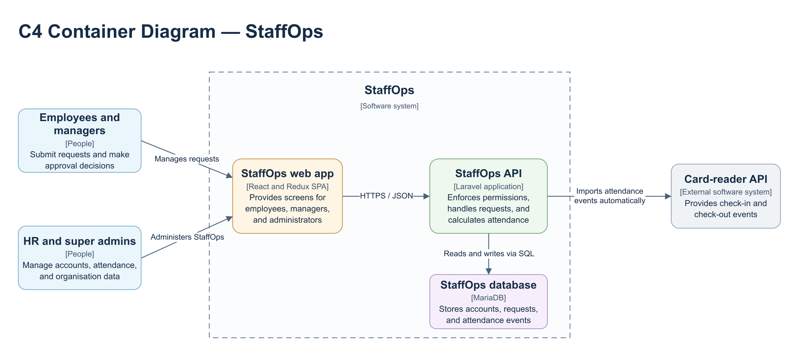

# StaffOps architecture

StaffOps is designed as a React web application backed by a Laravel REST API and a MariaDB database. The planned card-reader integration supplies attendance events to the backend.

- **React frontend.** Provides the employee, manager, and HR screens. Redux holds shared application state.
- **Laravel API.** Enforces permissions, validates input, handles request approvals, and calculates attendance. The browser uses the API for all reads and writes.
- **MariaDB.** Stores the organisation structure, accounts, reporting links, requests, approval decisions, and attendance events. See the [database design](database.md).
- **Card-reader API.** A scheduled backend import retrieves check-in and check-out events. Development uses sample data or a mock API while access to the real system is arranged.
